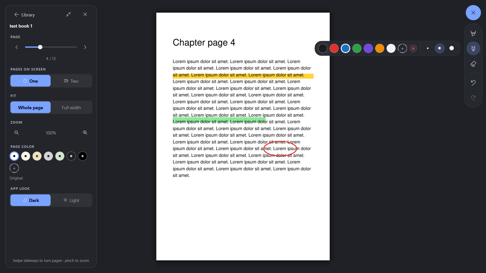

# Bookshelf

A clean, distraction-free desktop book reader for **Windows** and **Mac**, with highlighting,
pen drawing, and full touch-screen and touchpad support.



## Features

- **Library home screen** with book covers, reading progress and search; add books with a
  button or by dragging files in.
- **Remove a book** by right-clicking its cover → *Remove from library* (the file itself is
  kept). Books whose file was moved or deleted show *File not found*; click to remove them.
- **Full-screen reader**: one page or two pages side by side, *Whole page* or *Full width*.
- **Gestures**: pinch to zoom (it zooms exactly where your fingers are), drag to move,
  swipe sideways to turn pages. Works with touch screens, touchpads and the mouse.
- **Highlighter and pen** with your own colours and sizes; the highlighter straightens
  nearly-straight strokes. Circle **eraser**, step-by-step **undo / redo**.
- **Page colours** for comfortable reading (off-white, beige, grey, green, off-black,
  black, plus up to 3 of your own), and a **dark or light** app look.
- Remembers your page, layout and highlights for every book. **Book files are never changed.**

Opens PDF, EPUB, MOBI, FB2, XPS and CBZ files.

## Download

Installers are attached to the [Releases](../../releases) page:

| System | File |
|---|---|
| Windows 10 / 11 | `Bookshelf-Setup.exe` |
| Mac (M1 and newer) | `Bookshelf.dmg` |

The apps aren't signed by Microsoft or Apple, so the first launch shows a warning:
on Windows click **More info → Run anyway**; on a Mac use
**System Settings → Privacy & Security → Open Anyway**.

## Run from source

Needs Python 3.11 or newer.

```bash
pip install -r requirements.txt
python src/main.py
```

## Project structure

```
├── src/                         the app
│   ├── main.py                  entry point
│   └── bookshelf/
│       ├── app.py               main window: switches between library and reader, full screen
│       ├── library.py           Book records, covers, saving the library (library.json)
│       ├── library_view.py      home screen: book grid, search, add / remove books
│       ├── reader_view.py       the reader: page rendering, zoom, gestures, side panel,
│       │                        page colours, drawing input
│       ├── annotations.py       highlights and drawings: storage, undo / redo, eraser maths
│       ├── tools.py             the pen button and its tools, colours and sizes
│       ├── overlay.py           floating panels that fade in and out (frosted glass)
│       └── theme.py             colours (dark / light), stylesheet, icons, app icon
├── installers/                  everything for the two installers
│   ├── build_app.py             builds the installer for the system it runs on
│   ├── windows/                 installer.iss (settings) → Bookshelf-Setup.exe
│   └── mac/                     How to open.txt (shown in the .dmg) → Bookshelf.dmg
├── docs/screenshots/            pictures used in this README
├── .github/workflows/
│   └── build-mac.yml            runs installers/build_app.py on GitHub's Macs
│                                (GitHub only looks for build recipes in this folder)
└── requirements.txt
```

The finished `Bookshelf-Setup.exe` and `Bookshelf.dmg` are large, so they aren't
committed; publish them as Releases.

### How it fits together

- **`library.py`** holds the data. Each `Book` is identified by a hash of its file path;
  the library, covers and annotations are stored in the user's app-data folder.
- **`reader_view.py`** is the heart of the app. Pages are rendered with PyMuPDF and cached
  as pixmaps; while zooming or panning it draws cached images stretched and re-renders
  sharp copies once you stop (`_touch` / `_settle`). Very deep zoom renders only the
  visible part of a page. Layout is computed by `_metrics` / `_layout`, and positioning
  rules (centred at 100%, no empty gaps when zoomed) are in `_bounds`.
- **Input:** touch-screen events are handled in `_touch_event` (Windows' duplicate
  "pretend mouse" events from touch are ignored in `_from_touch`); touchpad pinches arrive
  as Ctrl + wheel on Windows and as native gestures on Mac. All pinch paths lock the
  page spot under the fingers (`_start_pinch` / `_pinch_to` / `_end_pinch`).
- **Annotations** are stored in page coordinates, so they stay in place at any zoom.
  Every change is one undo step of *(items removed, items added)*.
- **Theme:** colours live in `theme.PALETTES`; `theme.apply()` switches dark / light live.
  Icons come from the Segoe Fluent Icons font on Windows and the matching Phosphor icons
  (QtAwesome) elsewhere.

## Building installers

Run on the system you are building for:

```bash
pip install -r requirements.txt pyinstaller
python installers/build_app.py
```

- **Windows** → `installers/windows/Bookshelf-Setup.exe` (needs
  [Inno Setup 6](https://jrsoftware.org/isinfo.php)). Add `--test-installer` to also
  install, check and uninstall it automatically.
- **Mac** → `installers/mac/Bookshelf.dmg`. No Mac? Run **Actions → Build Mac app** on GitHub.

Every build starts the finished app, opens a sample book and checks it displayed before
packing the installer. Change `VERSION` at the top of `installers/build_app.py` for each release.

## Where data is stored

| System | Folder |
|---|---|
| Windows | `%APPDATA%\Bookshelf` |
| Mac | `~/Library/Application Support/Bookshelf` |

If something goes wrong, the details are written to `crash.log` in that folder.

## Keyboard shortcuts

| Keys | Action |
|---|---|
| ← → / Space / Page Up · Down | Previous / next page |
| ↑ ↓ | Scroll |
| Ctrl + / Ctrl − / Ctrl 0 | Zoom in / out / reset (⌘ on Mac) |
| 1 / 2 | One page / two pages |
| W | Whole page ↔ Full width |
| H or Tab | Show / hide the side panel |
| F or F11 | Full screen |
| Ctrl Z / Ctrl Y | Undo / redo |
| Esc | Close the drawing tools, then back to the library |
| Ctrl Shift G | Record a gesture log (for debugging touch input) |

## Built with

[PySide6 (Qt)](https://doc.qt.io/qtforpython-6/) · [PyMuPDF](https://pymupdf.readthedocs.io/) ·
[QtAwesome](https://github.com/spyder-ide/qtawesome) (Mac icons) ·
[PyInstaller](https://pyinstaller.org/) · [Inno Setup](https://jrsoftware.org/isinfo.php)
